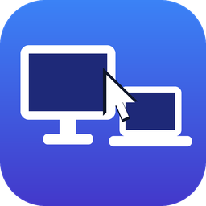
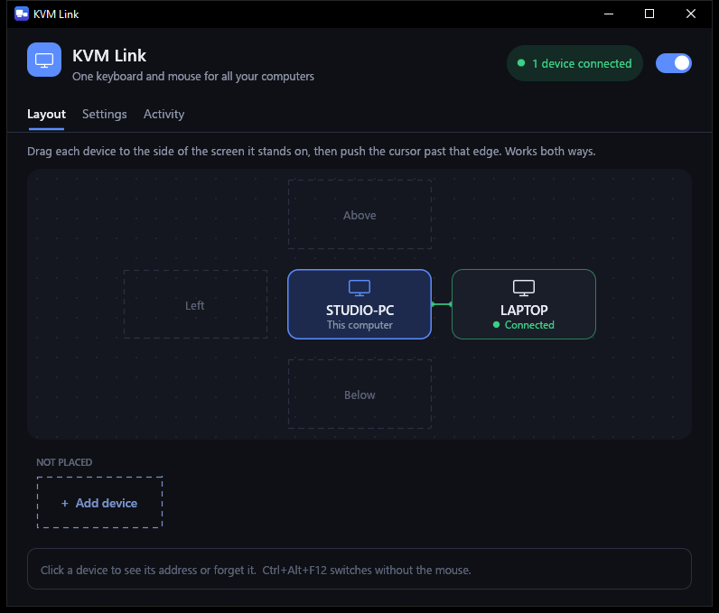

<p align="center">
  
</p>

<h1 align="center">KVM Link</h1>

<p align="center">
  One keyboard and mouse for several Windows computers over your local network.<br>
  Move the cursor past the edge of your monitor and keep working on the computer next to it.
</p>

<p align="center"></p>

## Features

- **Drag-and-drop layout.** Your computer sits in the middle; drag up to four paired devices to its left, right, top or bottom, the way they stand on your desk. Both computers update their layout automatically.
- **No roles, both ways.** Every computer is equal: use the keyboard and mouse of either one to control the other. Push the cursor past the edge where a device stands and control moves there; come back through the opposite edge. Touching the local mouse takes control back at once.
- **Edge switching and a hotkey.** `Ctrl+Alt+F12` moves the keyboard and mouse to the next connected device and finally back home. Screen corners never switch, so the close button of a maximised window stays reachable.
- **Low latency.** 25-byte frames, `TCP_NODELAY`, coalesced mouse motion and high-priority threads. On a cable or a good Wi-Fi link the delay is a few milliseconds.
- **PIN pairing.** One computer shows a 6-digit PIN, you type it on the other, and from then on they remember each other. No passwords.
- **Encryption.** All traffic is encrypted with ChaCha20-Poly1305.
- **Shared clipboard.** Text and images up to 16 MB, synced with every connected device. Big copies are sent in small chunks between mouse events, so the cursor never stalls.
- **LAN discovery.** Find the other computer with one click instead of typing an IP address.
- **Ignore a faulty built-in keyboard.** Useful when laptop keys get stuck and type on their own.
- **Service mode.** Keeps working in administrator windows and UAC prompts.
- **Tray icon and autostart.** A single portable `.exe`, no installer and no dependencies.

## Getting started

1. Download `kvmlink.exe` from [Releases](../../releases) and run it on **each** computer. Windows asks once to open a firewall port.
2. **On one computer** click **Add device → Show a PIN**. A 6-digit PIN appears for two minutes.
3. **On the other computer** click **Add device**, pick the first computer from the list (or type its address), enter the PIN and click **Pair**.
4. The new device lands next to yours on the layout. Drag it to the side where it actually stands.

Repeat for up to four neighbours. Paired devices find and reconnect to each other by themselves; enable **Start with Windows** in Settings and forget about it.

Devices you don't want on an edge right now can be dragged down to **Not placed**: they stay paired and keep sharing the clipboard. **Forget device** removes a pairing on both computers.

Closing the window hides it to the tray. To quit completely, use **Exit** in the tray icon's menu.

### Service mode

Windows does not let a normal program control windows that run as administrator or UAC prompts, so the cursor gets "stuck" on them. With **service mode** enabled (on each computer, one UAC confirmation each) the app starts at sign-in as SYSTEM, the same approach the Mouse Without Borders service in PowerToys uses, and those windows work too.

Keep in mind that in this mode anyone who holds the pairing key can also control protected Windows prompts.

## Security

| What | How |
|---|---|
| Pairing | [SPAKE2](https://datatracker.ietf.org/doc/rfc9382/) over a 6-digit PIN. Recorded traffic does not help guessing the PIN: each PIN allows 3 attempts and the pairing window stays open for 2 minutes. |
| Key | Every pair of devices gets its own 256-bit key, stored in `C:\ProgramData\kvmlink\config.txt`. The folder is readable only by SYSTEM, Administrators and your user. |
| Session | Every connection uses a fresh random salt and its own session key. Frames are encrypted with ChaCha20-Poly1305 and a counter, so tampering, replays and reordering are detected. |
| Network | Firewall rules allow the local subnet only. |

Not provided: forward secrecy. If the key in `config.txt` leaks, previously recorded traffic can be decrypted. To change the key, simply pair the devices again.

## Limitations

- Windows 10 and 11 only. Up to four neighbours around each computer; control goes to direct neighbours only.
- Edges are the outer edges of the whole desktop. With monitors of different sizes, an edge that does not touch the outer boundary does not switch.
- Version 0.3 pairs devices differently from 0.2: pair your computers again after updating.
- The clipboard carries text and images, not files.
- The cursor is sent as absolute coordinates, so games that use raw input may feel unusual.

## Ports

| Port | Protocol | Purpose |
|---|---|---|
| 24800 | TCP | keyboard, mouse, clipboard, pairing |
| 24800 | UDP | LAN discovery |

The port can be changed in Settings. It must be the same on every computer.

## Building

You need [Rust](https://rustup.rs) (stable) with either the MSVC or the GNU toolchain. For GNU you also need MinGW-w64 with `windres` on `PATH`.

```bash
cargo build --release
```

The result is `target/release/kvmlink.exe`. To regenerate the icon run `python assets/make_icon.py` (needs Pillow).

To debug on a single machine, run two independent copies with their own environment variables:

| Variable | Meaning |
|---|---|
| `KVMLINK_INSTANCE` | instance name, lets a second copy start; such a copy does not touch the firewall |
| `KVMLINK_CONFIG_DIR` | settings folder (put a `config.txt` with a different `port=` in each) |
| `KVMLINK_PEER_PORT` | port of the other copy |
| `KVMLINK_NO_HOOKS` | do not capture the keyboard and mouse (two copies on one PC would fight over them) |

### Code layout

| File | Contents |
|---|---|
| `src/net.rs` | Links between paired devices: capture (low-level hooks), injection (`SendInput`), pairing, discovery, layout sync |
| `src/proto.rs` | Record format, encryption, key derivation |
| `src/config.rs` | Settings file and the device layout |
| `src/clip.rs` | Clipboard sync |
| `src/ui.rs` | The window ([egui](https://github.com/emilk/egui)) |
| `src/tray.rs` | Tray icon and the hidden helper window |
| `src/setup.rs` | Firewall, autostart, service-mode task |
| `src/svc.rs` | Starts a SYSTEM copy in the user's session |

## Author

Created by [hellsing](https://github.com/hellsing123134).

## License

[MIT](LICENSE)
